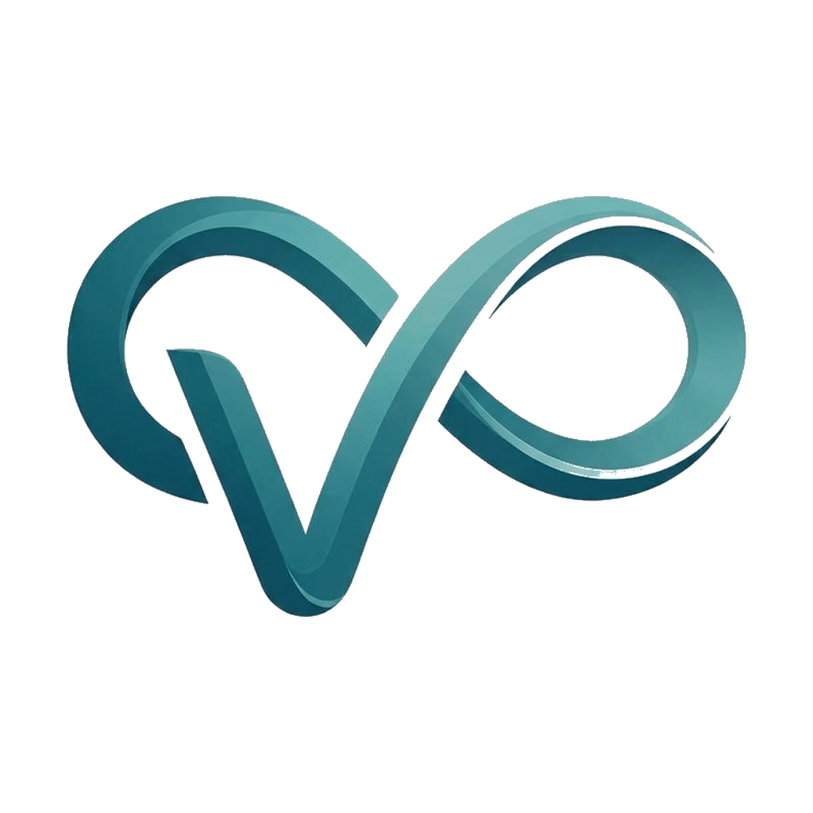

# Vunep

**Agile B2B software architecture & SaaS products** — custom systems, cloud infrastructure, and proprietary platforms built to move fast.

---

## What we do

Vunep designs and builds the systems behind B2B products that need to ship fast without cutting corners on architecture — from the first line of code to the infrastructure it runs on in production.

- **Custom SaaS platforms** — multi-tenant web apps, internal tooling, and client-facing products built end to end.
- **Cloud infrastructure & DevOps** — CI/CD pipelines, deployment automation, and production environments designed to scale without drama.
- **Systems architecture** — database design, API design, and the unglamorous foundational decisions that determine whether a product survives its first real growth spurt.

## How we build

Most of our work lives in private repositories — client work and internal products aren't open source by default — but this profile is where we show up publicly.

## Get in touch

**[vunep.com](https://vunep.com)** · **[support@vunep.com](mailto:support@vunep.com)**

